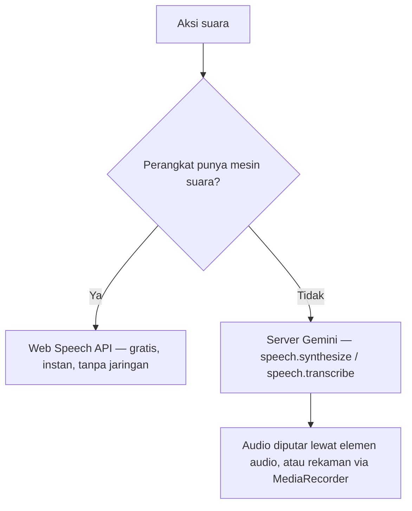
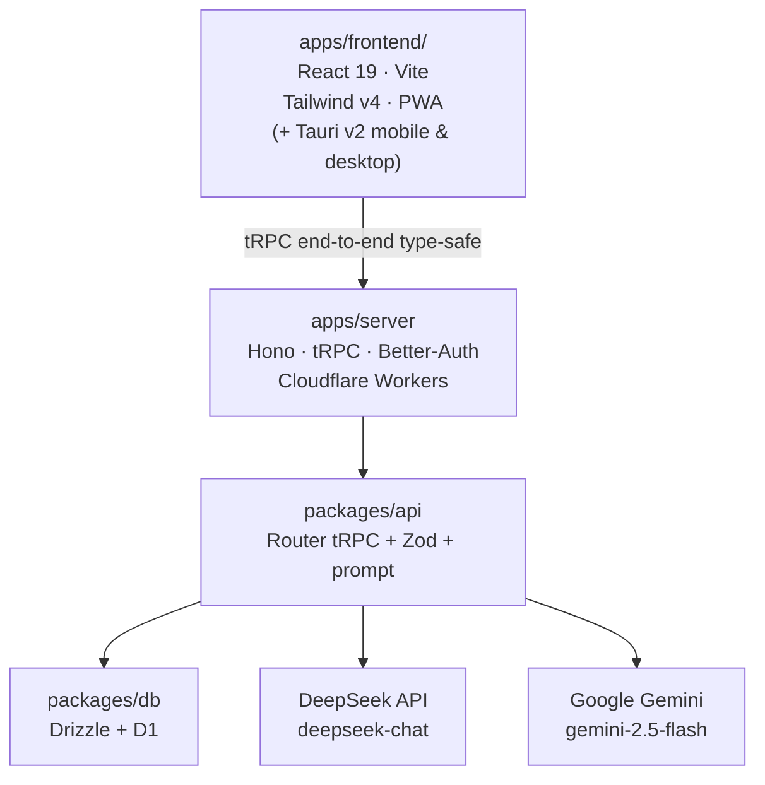

# Mudahin

**Platform pembelajaran inklusif & adaptif untuk siswa dengan kebutuhan khusus.**

Mudahin menyesuaikan cara materi dan kuis disajikan sesuai kebutuhan aksesibilitas tiap siswa — disleksia, ADHD, penglihatan rendah, dan kendala bahasa. Bukan sekadar "teks diperbesar": setiap bagian aplikasi (tipografi, pemandu baca, suara, bahasa materi, format kuis) beradaptasi pada satu **Focus Profile**.

> Hackathon JOINTS 2026 · Tema *Education* · Subtema *Siswa penyandang disabilitas / berkendala bahasa* · Target **WCAG 2.1 Level AA**.

---

## ✨ Fitur Inti

Aplikasi punya **4 tab** di tab bar bawah: **Belajar**, **Latihan**, **Akses**, **Profil**. Navbar atas (tidak sticky) selalu menampilkan lencana rentetan, XP, pintasan profil, dan tombol `tune` untuk membuka **bottom sheet aksesibilitas**.

| Fitur | Ringkasan |
|---|---|
| **Teman AI (input materi)** | Tulis topik, **ucapkan** (STT), unggah **foto catatan**, atau **PDF nyata** → AI menyusun ringkasan + soal, lalu materi disimpan ke pustaka. |
| **Pustaka Materi** | Daftar materi **milik pengguna dari database** (bukan contoh statis); filter subjek nyata; badge skor terbaik & "Sudah Dibaca". |
| **Pilih Jenis Latihan** | Mengetuk materi membuka dialog berisi **5 mode**: Kartu Tanya Jawab, Jawab dengan Suara, Dengarkan Bacaan Nyaring, Kuis Santai, dan Focus Reader. |
| **Focus Reader** | Tipografi adaptif, ukuran huruf A+, tombol **Buat Lebih Santai** (`ai.simplify`) dan **Jelaskan** (`ai.explain`) per paragraf. |
| **Reading Ruler** | Pemandu baris yang mengikuti kursor/jari (mobile: ikut geseran jari). |
| **Read-Aloud (TTS)** | Membacakan materi dengan Web Speech API, dan **jatuh ke suara server (Gemini TTS)** bila perangkat tidak punya mesin suara. |
| **Kartu Belajar (Flashcard)** | Dek kartu dibuat **lazy** via `ai.flashcards`; dibalik dengan ketukan, bisa dibacakan, diakhiri +30 XP. |
| **Jawab dengan Suara** | STT menjawab pertanyaan lisan; jawaban dicocokkan ke kata kunci dan diberi **evaluasi ramah**; auto-stop 12 detik. |
| **Dengarkan Bacaan Nyaring** | Pemutar narasi **berantai seluruh artikel** dengan suara latar penenang (Hening/Hujan/Alam) dan kontrol kecepatan. |
| **Kuis Santai Adaptif** | 3 soal dibuat **lazy** via `ai.quiz`; opsi dibacakan bila profil butuh; penjelasan ramah per soal. |
| **Materi dari Foto Tulisan Tangan** | Foto catatan → dibaca **Gemini vision** (`ai.ocrToFlashcards`) → ringkasan + kartu; teks hasil baca tampil untuk dikoreksi. |
| **Pengaturan Aksesibilitas** | Halaman **Akses** + **bottom sheet cepat** dari navbar, keduanya memakai komponen identik (satu sumber kebenaran). |
| **Profil & Progres** | Gamifikasi (XP/level/lencana), ringkasan progres dari server, dan **cadangan data** lintas perangkat. |
| **Cadangan & Pulihkan Data** | Seluruh data belajar (setelan, pustaka materi, skor) hidup lokal di perangkat dan dapat dipindahkan dengan satu "kode cadangan" (`backup.save`/`backup.load`), tanpa akun. |

**Status:** seluruh fitur di atas berjalan end-to-end. Tanpa akun, **setiap perangkat mulai dari nol** dan datanya tersimpan lokal; memulihkan data dari kode cadangan di halaman Profil adalah satu-satunya cara melanjutkan di perangkat baru. Fitur **Core (P0)** adalah Focus Reader, Reading Ruler, Read-Aloud (TTS), AI Text Simplifier, dan Kuis Adaptif. Fitur **Should-Have** yang juga selesai: kartu belajar, mode fokus, mode luring, STT, mind map, animasi, dan build Android Tauri. Sebagian **Future Work** dikerjakan karena waktu tersisa: getar/haptic, cadangan data lintas perangkat, dan OCR tulisan tangan. Daftar fitur lanjutan ada di [Future Work](#-future-work).

---

## 🚀 Menjalankan Proyek

**Prasyarat:** [Bun 1.3+](https://bun.sh). Jangan pakai npm/yarn/pnpm (lockfile resmi: `bun.lock`).

```bash
bun install          # pasang dependency semua workspace
```

Isi nilai rahasia (`DEEPSEEK_API_KEY`, `GEMINI_API_KEY`) di `.env` sesuai [Konfigurasi](#-konfigurasi) sebelum menjalankan fitur AI.

```bash
bun run dev:stack    # jalankan web + server lokal (Cloudflare bindings via Alchemy)
```

Ini menjalankan Worker server **beserta binding D1 dan secret**-nya secara lokal, lalu menautkan web ke server tersebut. Buka:

- Web — <http://localhost:3002>
- API — <http://localhost:3000>

Hanya ingin mengerjakan frontend (tanpa D1/AI lokal)? Pakai `bun run dev:web` (alias `bun run dev:frontend`).

### Frontend

Antarmuka web utama ada di **`apps/frontend/`** — satu layar mobile-first dengan 4 tab (Belajar, Latihan, Akses, Profil) yang **tersambung penuh ke backend** lewat tRPC. Ini adalah tampilan utama yang dibangun, dideploy, dan dibungkus sebagai aplikasi Tauri. Port **3002**.

```bash
bun run dev:web          # Vite, port 3002 (butuh server di port 3000)
```

`apps/frontend/` membaca materi dari `materials.list` dengan prioritas **server → salinan luring (IndexedDB) → kosong**, memakai `ai.simplify` / `ai.quiz` / `ai.flashcards` / `ai.explain` / `ai.mindMap` / `ai.ocrToFlashcards` untuk fitur AI (lazy, saat modul/modal dibuka), menyimpan materi baru lewat `materials.create`, menyimpan skor ke `progress.record`, dan mencadangkan seluruh data (setelan + pustaka + skor) lewat `backup.save` / `backup.load`. Semua data diikat ke **identitas perangkat** (`deviceId` lokal) — tanpa akun, tiap perangkat mulai dari nol sampai pengguna memulihkan kode cadangannya. Suara memakai Web Speech API dengan fallback `speech.synthesize` / `speech.transcribe`. Semua state AI dibuat di server (DeepSeek/Gemini) — tidak ada panggilan AI langsung dari klien.

Fitur non-UI yang dibagikan lintas permukaan (mobile & web) ada di `apps/frontend/src/lib/`: penyimpanan luring (`offline/idb.ts`), ekstraksi PDF (`pdf.ts`), cache materi (`materials/`), store Zustand (`stores/`), haptik (`haptics.ts`), animasi (`motion.ts`), pemilih mesin suara (`speech.ts`, `speech-stt.ts`, `speech-support.ts`, `speech-diagnostics.ts`), tokenizer Text-to-Speech (`tts.ts`), serta hook `online-status` / `persistent-state` / `reduced-motion` / `press-feedback` / `record-progress` / `profile-sync`.

Pastikan origin frontend (`http://localhost:3002`) ada di `CORS_ORIGIN` server (sudah disetel di `.env` lokal).

Untuk demo di HP, buka `http://<IP-komputer>:3002` dari jaringan yang sama (aplikasi ini mobile-first dan dapat dipasang sebagai PWA).

### Perintah Penting

| Perintah | Fungsi |
|---|---|
| `bun run dev:stack` | Web + server lokal sekaligus (via Alchemy, dengan bindings) |
| `bun run dev:web` | Frontend utama (`apps/frontend/`, Vite, port 3002) |
| `bun run dev:frontend` | Alias untuk `dev:web` |
| `bun run build` | Build semua aplikasi |
| `bun run check-types` | Cek tipe seluruh workspace |
| `bun run check` / `bun run fix` | Lint & format (Ultracite/Biome) |
| `bun run db:generate` | Generate migrasi Drizzle (tanpa snapshot) |
| `bun run db:generate:direct` | Panggil `drizzle-kit` langsung (dipakai bila butuh `--hints`) |
| `bun run env:generate` | Regenerate `src/env.ts` dari skema Varlock |
| `bun run prewarm` | Panaskan cache AI untuk semua materi demo |
| `bun run deploy` / `bun run destroy` | Deploy/hapus infrastruktur Cloudflare (Alchemy) — **sekaligus menerapkan migrasi D1** & mendeploy `apps/frontend/` sebagai situs web |

> **URL demo (live):** web — <https://mudahin-web-live-ahza-gynkahsdlthzwsrs.ahzathenation.workers.dev> · API — <https://mudahin-server-live-ahza-eugp63nlbibry2bu.ahzathenation.workers.dev>
> Catatan: `alchemy deploy`/`destroy` dipanggil dengan `--yes` (lihat `packages/infra/package.json`) dan task
> `deploy`/`destroy` di `turbo.json` **tidak** ditandai `interactive`, sehingga deploy bisa dijalankan
> tanpa TTY (CI/agent). Situs web yang dideploy adalah `apps/frontend/` (`rootDir: "../../apps/frontend"` di
> `packages/infra/alchemy.run.ts`).

### Migrasi D1 — otomatis saat deploy

**`bun run deploy` sudah menerapkan migrasi.** Tidak perlu menjalankan migrasi terpisah: Alchemy memiliki resource D1 beserta direktori migrasinya,

```ts
// packages/infra/alchemy.run.ts
export const db = Cloudflare.D1.Database("database", {
  migrations: "../../packages/db/src/migrations",
});
```

sehingga setiap deploy Alchemy mendeteksi migrasi yang baru/belum diterapkan di `packages/db/src/migrations`, menjalankannya berurutan, dan mencatatnya di tabel `__alchemy_migrations`. Database yang pernah dimigrasi dengan `drizzle-kit migrate`/`wrangler` **diadopsi satu arah** pada deploy pertama tanpa baselining.

Karena itu:

- **Jangan** menjalankan `drizzle-kit migrate`. `packages/db/drizzle.config.ts` sengaja tidak memuat kredensial D1 HTTP; `bun run db:migrate:deploy` kini hanya memuat pengingat, bukan perintah aplikasi.
- **Menambah skema** = tambah file di `packages/db/src/schema/`, lalu tambah migrasi di `packages/db/src/migrations/<timestamp>_<nama>/migration.sql`, lalu `bun run deploy`.
- **Memeriksa status** terhadap D1 lokal: `sqlite3 packages/infra/.alchemy/local/d1/*/*.sqlite "SELECT name FROM __alchemy_migrations ORDER BY id;"`

### Build Android (Tauri v2)

Proyek Android ter-generate di `apps/frontend/src-tauri/gen/android` (identifier `com.mudahin.app`). Pembungkus Tauri membangun dari `apps/frontend/` (port dev **3002**).

```bash
cd apps/frontend
export NDK_HOME="$ANDROID_HOME/ndk/<versi>"
bun run android:init            # hanya sekali, sudah dijalankan
bun run android:build           # APK rilis (kecil, bertanda tangan)
bun run android:build:debug     # APK debug (besar; ada simbol debug)
```

- **Rilis (disarankan untuk dibagikan/di-install)** — `bun run android:build`.
  Ukuran APK ~**5 MB** (arm64) karena profil Rust `release` memakai `strip`, `lto`,
  `opt-level="z"`, dan `panic="abort"` (lihat `src-tauri/Cargo.toml`). Rilis
  ditandatangani dengan keystore demo di `apps/frontend/src-tauri/gen/android/mudahin-release.keystore`
  (dapat dioverride lewat env `TAURI_ANDROID_KEYSTORE_PATH`, `TAURI_ANDROID_KEY_ALIAS`, `TAURI_ANDROID_KEYSTORE_PASSWORD`, `TAURI_ANDROID_KEY_PASSWORD`).
- **Debug** — `bun run android:build:debug`. Ukurannya jauh lebih besar (~130 MB)
  karena `.so` menyertakan simbol debug; pakai hanya saat men-debug native.

APK hasil build:

- Rilis: `apps/frontend/src-tauri/gen/android/app/build/outputs/apk/universal/release/`
- Debug: `apps/frontend/src-tauri/gen/android/app/build/outputs/apk/universal/debug/`

> **Penting — APK harus menunjuk ke server yang benar.**
> `apps/frontend/src/lib/env.ts` membaca `VITE_SERVER_URL` saat build. Tanpa nilai itu,
> fallback `http://localhost:3000` ter-bundle ke APK dan aplikasi **tidak bisa memuat
> materi** (localhost di HP = HP itu sendiri). Nilai produksi diambil dari
> `apps/frontend/.env.production` (ikut di-commit; hanya `VITE_*` non-rahasia).
> Setelah `bun run deploy`, salin URL server baru ke file itu lalu build ulang APK.
>
> Server sudah mengizinkan origin WebView Tauri (`http://tauri.localhost`,
> `https://tauri.localhost`, `tauri://localhost`) lewat CORS — lihat
> `apps/server/src/env.server.ts` (`desktopOrigins`). Bila server pindah domain,
> pastikan `CORS_ORIGIN` di `packages/infra/.env` memuat origin web baru.

Untuk **desktop**, dari `apps/frontend/`:

```bash
bun run desktop:dev      # jalankan jendela Tauri (dev)
bun run desktop:build    # build aplikasi desktop
```

> **Catatan:** build rilis Rust butuh ruang disk beberapa GB; build debug lebih ringan untuk demo.

---

## 🧭 Alur Demo (5 Detik)

> **Belajar → tulis/unggah topik → Olah Materi → pustaka terisi → pilih materi → pilih latihan → Kuis/Dengarkan → Hasil.**

1. **Belajar** — tulis topik di kotak **Teman AI**, atau lampirkan **foto catatan** / **file PDF** / tekan tombol **Bicara**. Tekan **Olah Materi dengan Teman AI**.
2. **Materi tersimpan** — AI membuat ringkasan + kuis, materi masuk **Materi Pustaka** (tampil di kartu "Lanjut Belajar Terakhir" bila paling baru).
3. **Pilih materi** — ketuk materi → dialog **Pilih Jenis Latihan** muncul.
4. **Focus Reader** — aktifkan *Garis Baca* & *Warna Hangat*; tekan **Buat Lebih Santai** untuk ringkasan AI, **Dengarkan** untuk TTS, atau **Selesai Membaca (+20 XP)**.
5. **Kuis / Dengarkan** — jawab **Kuis Santai Adaptif** dan lihat pembahasan, atau buka **Dengarkan Bacaan Nyaring** untuk narasi berantai.
6. **Profil** — lihat XP, level, lencana, rata-rata skor, dan coba **Cadangan & Pulihkan Data** lintas perangkat.

Misi harian (Bacaan Fokus + Kuis Adaptif) muncul di halaman Belajar dan memberi bonus +50 XP bila keduanya tuntas.

**Protokol sebelum pitch:** jalankan `bun run prewarm` agar hasil AI (ringkasan, kuis, kartu belajar) tersimpan di cache, lalu uji aplikasi dalam mode luring. Materi tetap tersedia dari salinan lokal saat jaringan mati.

---

## ⚙️ Cara Kerja Fitur

Bagian ini menjelaskan mekanika tiap fitur sesuai kode yang berjalan saat ini (`apps/frontend/src/`, `packages/api/src/`).

### 🧭 Alur Navigasi

- **4 tab (BottomNavBar)** — `Belajar`, `Latihan`, `Akses`, `Profil`. Tab bar selalu *fixed*; navbar atas sengaja **tidak sticky**.
- **Navbar atas (TopAppBar)** — tampil **identik di semua tab**: logo ikon, lencana rentetan (`streakDays`), lencana XP, tombol profil, dan tombol `tune` untuk membuka **AccessibilitySheet**.
- **Bottom sheet** dan halaman Akses memakai komponen `AccessibilitySettings` yang sama, sehingga perilakunya selalu identik.

### 📚 Materi (Pustaka)

- **Sumber tunggal** = tabel `materials` di D1, dibaca lewat `materials.list` / `materials.byId`. Tidak ada seed/dummy lagi: pustaka kosong berarti pengguna memang belum punya materi.
- **Kepemilikan** ditentukan `userId`: `session.user.id` bila login, selain itu `"anon"` (per perangkat) — lihat `packages/api/src/routers/materials.ts`.
- **Prioritas baca** (`useMaterials` di `lib/hooks/use-materials.ts`): **server → salinan luring (IndexedDB) → kosong**. Hasil daring selalu disalin ke IndexedDB agar mode luring berikutnya bekerja.
- **Adaptor UI** (`lib/api/materials.ts`) mengubah `Material` backend menjadi `LearningModule` di tepi: menambah ikon/warna per subjek, badge, dan `voicePrompt` bawaan.
- **Progres** dari `progress.summary` dilampirkan ke tiap modul sebagai **skor kuis terbaik** (`withProgressScores`).

### ✍️ Membuat Materi ("Teman AI")

Alur `handleGenerateModule` di `app.tsx`:

1. **Input** — teks bebas, hasil **STT** (tombol *Bicara*), dan/atau berkas.
2. **Berkas** — **foto** jadi data URL → OCR Gemini; **PDF** teksnya diekstrak di klien (`lib/pdf.ts`, worker pdf.js dibundel lokal, maks 20 halaman). PDF hasil pindai tanpa lapisan teks menampilkan pesan jujur.
3. **AI** — `ai.simplify` (ringkasan) dan `ai.quiz` (3 soal) dijalankan **bersamaan** lewat `Promise.all` (server men-cache).
4. **Simpan** — hasil ditulis ke DB via `materials.create`, lalu muncul di pustaka sebagai modul baru.

### 📖 Focus Reader

- Tipografi adaptif: tombol **A+** menaikkan ukuran huruf; **Garis Baca** dan **Warna Hangat** bisa dinyalakan langsung dari header.
- **Buat Lebih Santai** memanggil `ai.simplify` lalu menyebar poin ke tiap paragraf (`applySimplifiedPoints`); paragraf tanpa poin tetap memakai teks asli.
- **Jelaskan** memanggil `ai.explain` untuk paragraf aktif, hasilnya muncul di bawah paragraf tersebut.
- **Dengarkan** membacakan paragraf aktif (memakai teks tersederhana bila mode santai aktif).
- **Selesai Membaca (+20 XP)** menandai misi bacaan dan menambah modul ke daftar "Sudah Dibaca". Progres bacaan **tidak** dikirim ke `progress.record` (prosedur itu berorientasi kuis).

### 🎮 Pusat Latihan & Pilih Jenis Latihan

- Halaman **Latihan** menampilkan seluruh materi milik pengguna, dengan pencarian judul dan filter subjek nyata.
- Mengetuk materi (dari **Belajar** maupun **Latihan**) membuka **PracticePickerSheet** yang sama. Ada **5 mode** (`PRACTICE_KINDS` di `practice-picker-sheet.tsx`):

| Mode | Cara kerja |
|---|---|
| 🃏 **Kartu Tanya Jawab** | Dek dibuat lazy via `ai.flashcards`; balik kartu dengan ketukan, tandai *Sudah Paham/Belum Paham*, diakhiri +30 XP. |
| 🎙️ **Jawab dengan Suara** | STT (`useSpeechRecognition`) menampilkan transkrip; jawaban dicocokkan ke `expectedKeywords` (lulus bila ≥2 kata kunci). Auto-stop 12 detik; tanpa STT muncul pesan jujur. |
| 🎧 **Dengarkan Bacaan Nyaring** | Memutar seluruh artikel **berantai** dari paragraf terpilih sampai akhir, dengan suara latar penenang dan kontrol kecepatan (0.75×/1.0×/1.2×). |
| 🧩 **Kuis Santai Adaptif** | Soal dibuat lazy via `ai.quiz`; skor akhir dikirim ke `progress.record`. |
| 📖 **Focus Reader** | Membuka pembaca tipografi adaptif. |

### 🧩 Kuis Adaptif & Progres

- Soal dibuat **lazy** saat modal dibuka (bila modul belum punya kuis) lewat `ai.quiz`, lalu divalidasi Zod di server.
- Opsi jawaban bisa **dibacakan** (tombol speaker) bila profil pengguna membutuhkannya.
- Skor dihitung `Math.round((correct / total) * 100)` lalu disimpan lewat `progress.record` (menyimpan **skor terbaik** + menambah hitungan kuis). Bila server mati, skor tetap disimpan lokal dan UI memberi tahu.

### 💤 Mode Luring (Offline)

- **IndexedDB** (`lib/offline/idb.ts`, fallback `localStorage`) menyimpan salinan materi dan hasil AI terakhir.
- Urutan sumber materi: **server → salinan luring → kosong**. Aplikasi tetap terbaca saat jaringan mati.
- `bun run prewarm` memanaskan cache AI di D1 supaya hasil (ringkasan, kuis, kartu) instan saat demo.

### 🏆 Gamifikasi (XP, Level, Lencana, Misi)

- **XP** diperoleh dari tindakan nyata: selesai baca +20, kuis +40, flashcard +30, jawab suara +25, klaim bonus misi +50.
- **Level** = `floor(xp / 50) + 1`; bilah progres menuju level berikutnya.
- **Misi harian** (Bacaan Fokus + Kuis Adaptif) ditandai otomatis saat Focus Reader selesai dan saat kuis diselesaikan.
- **Lencana** terbuka berdasarkan ambang XP dan aktivitas (mis. kuis pernah dikerjakan).
- **Rentetan** memakai jumlah materi yang dikerjakan (`progress.summary.quizzedCount`).

### ♿ Fitur Pembantu Disabilitas (Aksesibilitas)

Semua preferensi hidup lokal (`usePersistentState`) dan dihimpun menjadi satu **Focus Profile** yang dikirim ke AI (`deriveFocusProfile` di `lib/api/ai.ts`).

| Preferensi | Cara kerja |
|---|---|
| **Ukuran huruf (A-/A/A+/A++)** | Dipetakan ke skala `0.88`–`1.3` pada variabel CSS `--a11y-font-scale` di `<body>`; seluruh UI memakai `rem`, jadi **satu nilai menskalakan semua teks**. |
| **Font Ramah Disleksia (Lexend)** | Menambahkan kelas `font-dyslexia` pada pembungkus aplikasi; khusus profil disleksia. |
| **Garis Pembimbing Baca (Reading Ruler)** | `ReadingGuideOverlay` menggambar garis yang mengikuti kursor; di mobile mengikuti **geseran jari** (bawaan: sepertiga atas layar). |
| **Filter Warna Hangat (Anti Silau)** | Mengaktifkan kelas `theme-warm` (latar sepia/krem) untuk mengurangi kelelahan mata. |
| **Kecepatan suara (0.8×/1.0×/1.25×)** | Diteruskan ke `speakText` sebagai `rate`, dinormalkan ke rentang 0.5–2×. |
| **Getar/haptic** | Getar opsional via `navigator.vibrate` pada mikro-interaksi tekan (`lib/haptics.ts`). |
| **Kurangi animasi** | Animasi GSAP menghormati `prefers-reduced-motion` **dan** preferensi aplikasi. |

**Focus Profile** yang dikirim ke AI: font disleksia → `disleksia`; huruf ekstra besar atau warna hangat → `low-vision`. Profil ini membuat bahasa/format keluaran AI menyesuaikan kebutuhan.

### 🔊 Suara (TTS & STT) — Dua Jalur Otomatis

Fitur suara memakai strategi **Web Speech API dulu, fallback server** (Gemini) — penting karena **WebView Android/Tauri umumnya tidak mengekspos mesin suara**.



- **TTS** (`lib/tts.ts` → `lib/speech.ts`): memilih suara `id-ID` setelah `voiceschanged`, `resume()` mengatasi bug "paused", dan **watchdog 1,2 detik** mencegah narasi macet. Bila mesin suara tak ada, audio diambil dari `speech.synthesize` (di-cache di D1 agar kalimat sama tidak disintesis dua kali).
- **STT** (`lib/speech-stt.ts`): memakai Web Speech API bila ada; jika tidak, merekam lewat `MediaRecorder` (maks 30 detik) dan mengirimnya ke `speech.transcribe`. Kesalahan (izin ditolak, tanpa mikrofon, tanpa jaringan) dipetakan ke **pesan ramah**, bukan gagal diam-diam.
- **Halaman Akses** menampilkan **diagnostik jujur** perangkat (`lib/speech-diagnostics.ts`), mis. *"Suara: tersedia (12 voice, ID ✓) · Perekam: tersedia"*.

### 👤 Profil, Cadangan & Kunci API

- **Profil** menampilkan level, XP, ringkasan progres dari `progress.summary`, rentetan, dan koleksi lencana.
- **Cadangan data** menyimpan snapshot **lengkap** (setelan, pustaka materi, skor) dengan `backup.save` (kode `syncId` ≥4 karakter) dan memulihkannya dengan `backup.load` + `data.import` — **tanpa akun**. Murni tingkat-MVP; tidak ada role/multi-pengguna.
- **AI hanya dipanggil dari server** (`ai.*` dan `speech.*`), tidak pernah langsung dari klien. Key rahasia (DeepSeek/Gemini) tidak pernah ikut ter-bundle ke client.

---

## 🏗️ Arsitektur

Monorepo **Turborepo + Bun workspaces** dengan pemisahan tegas antara *apps* (deployable) dan *packages* (library internal).



| Lapisan | Teknologi |
|---|---|
| Monorepo | Turborepo + Bun workspaces |
| Frontend | React 19, Vite, TanStack Query, Zustand, Tailwind v4, PWA |
| Backend | Hono + tRPC di Cloudflare Workers (deploy via Alchemy) |
| Database | Cloudflare D1 (SQLite) + Drizzle ORM |
| AI teks | DeepSeek `deepseek-chat` (server-side, timeout 8s, retry 1×, cache di D1) |
| AI gambar/audio | Google Gemini `gemini-2.5-flash` — OCR tulisan tangan + TTS/STT server |
| TTS/STT | Web Speech API di klien, **fallback server** Gemini bila perangkat tidak mendukung |
| PWA | `vite-plugin-pwa` — dapat dipasang & luring |
| Mobile/Desktop | Tauri v2 (`apps/frontend/src-tauri`) |

### Prosedur tRPC

| Router | Prosedur | Fungsi |
|---|---|---|
| `ai` | `simplify`, `quiz`, `explain`, `mindMap`, `flashcards`, `ocrToFlashcards` | Seluruh fitur AI teks (DeepSeek) + OCR (Gemini); tiap hasil di-cache di D1 & divalidasi Zod. |
| `speech` | `synthesize`, `transcribe` | TTS/STT server-side (Gemini) untuk perangkat tanpa Web Speech API. |
| `materials` | `list`, `byId`, `create` | Pustaka materi milik pengguna dari database. |
| `progress` | `record`, `summary` | Simpan skor kuis terbaik & ringkasan progres. |
| `profile` | `save`, `load` | Cadangan/pemulihan setelan lewat kode, tanpa akun. |

### Struktur Folder

```
mudahin/
├── apps/
│   ├── frontend/    # Frontend utama (React + Vite + Tailwind + PWA) + Tauri v2
│   │   └── src-tauri/   # Pembungkus Tauri v2 (desktop + Android)
│   └── server/      # Hono + tRPC (Cloudflare Worker)
├── packages/
│   ├── api/         # Kontrak & logika: router tRPC, skema Zod, prompt, cache AI
│   ├── auth/        # Konfigurasi Better-Auth
│   ├── db/          # Skema Drizzle + migrasi
│   ├── ui/          # Komponen shadcn & token aksesibilitas lintas-app
│   ├── config/      # tsconfig & preset lint bersama
│   └── infra/       # Definisi infrastruktur Alchemy (Worker + D1 + Website → apps/frontend)
├── scripts/         # Utilitas (prewarm, verifikasi)
└── turbo.json
```

Fitur non-UI `apps/frontend/` berada di `apps/frontend/src/lib/` (offline, materials, stores, haptics, motion, tts, speech-recognition, hooks); UI di `apps/frontend/src/components/`.

> **Catatan:** dokumen teknis tambahan (`ATURAN-TEKNIS.md`, `SRS-mudahin.md`, `RUNDOWN.md`, `PLAN.md`, `TODO.md`) berada di **root repository** (satu tingkat di atas `mudahin/` untuk tiga yang pertama).

---

## ♿ Aksesibilitas

Dibangun mengacu pada **WCAG 2.1 AA**:

- Rasio kontras teks minimum **4.5:1** (tersedia mode **Filter Warna Hangat/Anti Silau**).
- Target sentuh minimum **44×44 px**; aplikasi mobile-first & *gesture friendly* (bottom sheet, tab bar bawah, area aman perangkat).
- **Ruang aman perangkat** dijaga untuk notch, status bar, dan home/gesture bar lewat `env(safe-area-inset-*)` yang dinormalisasi jadi `--safe-*` (lihat [Ruang Aman Perangkat](#ruang-aman-perangkat-notch-status-bar-home-bar)).
- Setiap kontrol punya **ARIA label** dan dapat diakses keyboard; ikon aksi utama selalu disertai label teks.
- **Ukuran teks berskala global.** Seluruh tipografi memakai satuan `rem` dengan basis `calc(16px * var(--a11y-font-scale))`, sehingga memilih A-/A/A+/A++ menskalakan *semua* teks sekaligus (tidak ada label yang tertinggal kecil).
- **Dialog & bottom sheet relatif terhadap ukuran layar** (`.dialog-layer`), bukan terhadap konten yang digulir: panel selalu tampil di tengah/tepi area pandang yang terlihat, tanpa perlu menggulir ke bawah.
- **Tab bar bawah selalu terlihat** (`fixed`) di semua halaman; navbar atas sengaja **tidak sticky** agar area baca tetap lega di layar kecil.
- Informasi tidak pernah disampaikan hanya lewat warna.
- Animasi (GSAP) menghormati `prefers-reduced-motion` **dan** preferensi "Kurangi animasi" di aplikasi.
- Getar/haptic opsional ("Getar saat menekan") — nonaktif secara bawaan & hanya berjalan bila perangkat mendukung.
- Font **Lexend** tersedia sebagai "Font Ramah Disleksia".

### Ruang Aman Perangkat (Notch, Status Bar, Home Bar)

Aplikasi menggambar sampai tepi layar (*edge-to-edge*) dan menahan kontennya sendiri:

- `<meta viewport ... viewport-fit=cover>` + `enableEdgeToEdge()` di `MainActivity.kt` membuat `env(safe-area-inset-*)` bernilai nyata di iOS/Android.
- Nilai tersebut dinormalisasi menjadi `--safe-top` / `--safe-right` / `--safe-bottom` / `--safe-left` di `index.css` — satu sumber kebenaran.
- **Navbar atas** menahan notch/status bar & kamera punch-hole; **tab bar bawah** menahan home/gesture bar; **panel dialog & sheet** menahan keempat sisinya (penting saat ponsel dirotasi mendatar).
- Android 9–14: `layoutInDisplayCutoutMode = SHORT_EDGES` di `MainActivity.kt` agar area cutout benar-benar dipakai.
- Di desktop semua inset bernilai 0, jadi tampilan tidak berubah.

### Fitur Suara (TTS & STT) di Mobile & Desktop

Pembacaan suara memakai **Web Speech API** dengan **fallback server (Gemini)** yang tahan terhadap kendala platform:

- **Dua jalur otomatis**: Web Speech API dipakai bila tersedia; kalau tidak (WebView Android/Tauri), suara diambil dari `speech.synthesize` dan diputar lewat `<audio>`.
- **Kecepatan dinormalkan** ke 0.5–2× (sebagian mesin suara Android menolak nilai lain).
- **Suara Bahasa Indonesia** dipilih setelah `voiceschanged` — daftar suara sering kosong pada panggilan pertama di Android.
- **Antrean ucapan dipulihkan** (`resume()`) untuk mengatasi bug mesin suara yang langsung "paused".
- **Watchdog 1,2 detik**: bila ucapan tidak pernah dimulai (mesin suara rusak/voiceless), rantai narasi tidak macet — `onEnd` tetap dipanggil.
- **Diagnostik di layar Aksesibilitas** (`lib/speech-diagnostics.ts`) menampilkan status jujur perangkat, mis. *"Suara: tersedia (12 voice, ID ✓) · Perekam: tersedia"*, dan memperbarui diri saat voice selesai dimuat.
- **STT**: memakai Web Speech API bila ada; jika tidak, `MediaRecorder` merekam (maks 30 detik) dan dikirim ke `speech.transcribe`. Kesalahan dipetakan ke pesan ramah (izin ditolak, mikrofon tak ada, tanpa jaringan) dan ditampilkan — bukan gagal diam-diam.
- **APK Android**: `AndroidManifest.xml` menyertakan `RECORD_AUDIO` serta `<queries>` untuk `TTS_SERVICE` & `RecognitionService`, sehingga Android 11+ dapat menemukan mesin suara sistem.
- Pemutar narasi (`AudioNarrationModal`) membacakan **seluruh artikel secara berantai** dari paragraf yang dipilih, tidak lagi berhenti di paragraf terakhir.

> **Penting:** WebView Android kadang tidak menyediakan `speechSynthesis` sama sekali. Bila suara perangkat
> tidak ada, aplikasi otomatis memakai **suara server**. Bila ingin jalur lokal, pasang
> **Speech Recognition & Synthesis** (Google) dari Play Store lalu buka ulang aplikasi.
> Di desktop/PWA suara langsung aktif.

---

## 🔌 Konfigurasi

Konfigurasi environment memakai **Varlock**: hanya file `*.env.schema` yang di-commit (tanpa nilai rahasia).

| File skema | Variabel |
|---|---|
| `apps/server/.env.schema` | `NODE_ENV`, `BETTER_AUTH_SECRET`, `BETTER_AUTH_URL`, `CORS_ORIGIN`, `DEEPSEEK_*`, `GEMINI_*`, `PREWARM_TOKEN` |
| `packages/infra/.env.schema` | Impor server + `DEEPSEEK_API_KEY`, `DEEPSEEK_BASE_URL`, `DEEPSEEK_MODEL`, `GEMINI_API_KEY`, `GEMINI_BASE_URL`, `GEMINI_MODEL`, `PREWARM_TOKEN`, `ALCHEMY_PASSWORD` |

Salin skema ke `.env` lokal (mis. `packages/infra/.env`) dan isi nilai rahasianya. Alchemy memuat dan memvalidasi nilai ini saat `bun run dev:stack` / `bun run deploy`, lalu menyuntikkannya ke Worker sebagai binding. File `.env` **gitignored** — jangan pernah commit secret, dan jangan memakai prefix `VITE_` untuk key rahasia (variabel `VITE_*` ikut ter-bundle ke client).

> **Gemini:** dipakai oleh **OCR tulisan tangan** (`ai.ocrToFlashcards`, Future F3) **dan** jalur cadangan
> **suara server-side** (`speech.synthesize` / `speech.transcribe`) untuk perangkat tanpa Web Speech API.
> Isi `GEMINI_API_KEY` untuk mengaktifkan keduanya; bila kosong, fitur lain tetap jalan, halaman foto
> menampilkan pesan belum dikonfigurasi, dan suara otomatis memakai Web Speech API lokal.
> Provider AI **fitur teks tetap DeepSeek**.

---

## 🛡️ Ketahanan Demo

- **Timeout 8 detik** + 1 retry untuk setiap panggilan DeepSeek (Gemini 10 detik untuk OCR); kegagalan menampilkan banner fallback (layar tidak pernah kosong).
- **Cache hasil AI di D1** dengan key = hash `(endpoint + versi prompt + input)` → respons identik tidak memanggil API ulang. TTS juga di-cache per kalimat.
- **Mode luring penuh (IndexedDB)** — materi, ringkasan, peta pikiran, kartu belajar, dan kuis terakhir disalin ke perangkat (`apps/frontend/src/lib/offline/idb.ts`). Pustaka & Focus Reader memakai prioritas: server → salinan luring → kosong (keadaan kosong jujur, tanpa seed palsu), sehingga aplikasi tetap terbaca saat jaringan mati.
- Semua respons AI **divalidasi Zod** sebelum dikirim ke client.
- **Verifikasi util kritis**: `bun run verify` (reading ruler, parser JSON LLM, guard anti-loop, STT, deteksi platform TTS, cache luring, skema materi DB).

---

## 🤖 Pencantuman AI

Sesuai Rules Lomba, peran AI dalam proyek ini:

| Tahap | AI / Tools | Peran |
|---|---|---|
| Riset & penulisan SRS | LLM asisten | Penyusunan dokumen & pemetaan kebutuhan |
| Pengembangan kode | AI coding assistant | Scaffolding monorepo, komponen UI, integrasi tRPC/Drizzle |
| **Fitur produk** | **DeepSeek `deepseek-chat`** | Penyederhanaan teks, generasi kuis, penjelasan, peta pikiran, kartu belajar (seluruh fitur teks) |
| **Fitur produk** | **Google Gemini (`gemini-2.5-flash`)** | **OCR tulisan tangan → kartu belajar** (Future F3) dan **TTS/STT server-side** (`speech.synthesize`/`speech.transcribe`) untuk perangkat tanpa Web Speech API. Endpoint OpenAI-compatible untuk OCR |
| **Fitur produk** | **Web Speech API** (bukan AI generatif) | TTS & STT di sisi klien (jalur utama, sebelum fallback server) |
| Desain UI/UX | AI design assistant | Eksplorasi layout & sistem warna ramah aksesibilitas |

---

## 🌱 Future Work

Beberapa item roadmap berikut **sudah** dikerjakan sebagian karena waktu tersisa, sisanya tetap di proposal (SRS Bagian 8):

**Sudah dikerjakan (bonus):**

- **Haptic feedback** — getar opsional via `navigator.vibrate`, tersambung ke mikro-interaksi tekan (`lib/haptics.ts`, toggle "Getar saat menekan").
- **Cadangan data lintas perangkat** — simpan/pulihkan setelan, pustaka materi, dan skor lewat "kode cadangan" (tabel `device_backup`, prosedur `backup.save`/`backup.load` + `data.export`/`data.import`); tanpa akun.
- **Kartu Belajar (flashcard)** — dibuat dari teks materi (FR-LEA-04).
- **OCR tulisan tangan → kartu belajar** (F3) — foto catatan dibaca **Gemini vision** (`ai.ocrToFlashcards`), teks hasil baca ditampilkan untuk dikoreksi.
- **Build Android Tauri v2** (Should-6) — proyek Android di `apps/frontend/src-tauri/gen/android`, APK arm64 dengan identifier `com.mudahin.app`.

**Masih roadmap:** avatar isyarat **BISINDO 3D**, **AI Dialect Adapter** bahasa daerah, **Teacher & Parent Dashboard** multi-pengguna, akun & sinkronisasi penuh antar-akun, dan evaluasi khusus siswa tunarungu.

---

## 📄 Lisensi

Karya orisinal untuk Hackathon JOINTS 2026.
