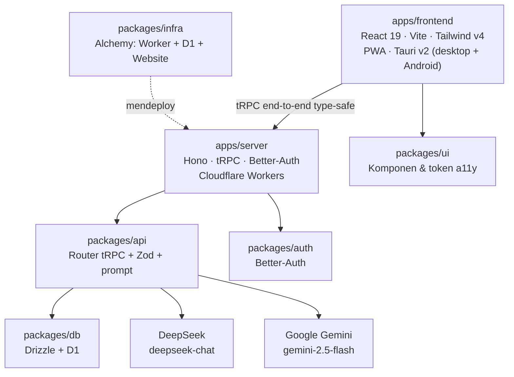

# Mudahin

**Platform pembelajaran inklusif & adaptif untuk siswa dengan kebutuhan khusus.**

Mudahin menyesuaikan cara materi dan kuis disajikan sesuai kebutuhan aksesibilitas tiap siswa — disleksia, ADHD, penglihatan rendah, dan kendala bahasa. Bukan sekadar "teks diperbesar": tipografi, pemandu baca, suara, bahasa materi, dan format kuis semuanya beradaptasi pada satu **Focus Profile**.

> Hackathon JOINTS 2026 · Tema *Education* · Subtema *Siswa penyandang disabilitas / berkendala bahasa* · Target **WCAG 2.1 Level AA**.

---

## ✨ Fitur Inti

Aplikasi adalah **satu layar mobile-first dengan empat tab**: **Belajar**, **Latihan**, **Akses**, dan **Profil**.

| Tab | Fitur | Ringkasan |
|---|---|---|
| **Belajar** | Onboarding & Profil Aksesibilitas | Pilih kebutuhan (multi-pilih); preset tipografi diterapkan otomatis. |
| | Pustaka Materi | Materi milik pengguna; impor PDF atau ketik manual ("Olah Materi dengan Teman AI"). |
| | Focus Reader | Tipografi adaptif, pengaturan jarak baris/huruf, font disleksia. |
| | Reading Ruler | Pemandu baris yang mengikuti bacaan, bisa digeser dengan jari. |
| | Read-Aloud (TTS) | Membacakan materi dengan penanda kata aktif; kecepatan 0.5–2×. |
| | Sederhanakan (AI) | Ringkasan poin-poin, peta pikiran (*mind map*), dan penjelasan per bagian. |
| | Kartu Belajar (Flashcard) | Dek kartu tanya-jawab dari materi; dibalik dengan ketukan, bisa dibacakan. |
| | Mode Fokus | Menampilkan satu blok teks pada satu waktu dengan tipografi besar. |
| **Latihan** | Kuis Adaptif | Soal dibuat dari materi; pada profil tertentu soal dapat dibacakan. |
| | Hasil Kuis | Skor, pembahasan jawaban salah, dan opsi mengulang bagian yang salah. |
| | Latihan Lisan | Jawab dengan **suara** (STT); dinilai deterministik lewat kecocokan kata kunci. |
| | Riwayat Latihan | Daftar percobaan kuis & lisan beserta skornya. |
| | Gamifikasi | XP, rentetan (streak) harian, dan misi harian. |
| **Akses** | Pengaturan Aksesibilitas | Semua toggle preferensi dalam satu halaman (termasuk getar/haptic). |
| **Profil** | Profil & Progres | Ringkasan kebutuhan, penyesuaian aktif, dan ketuntasan pustaka. |
| | Cadangan Lintas Perangkat | Simpan/pulihkan data lewat "kode cadangan" (`syncId`) — **tanpa akun**. |

**Status:** seluruh fitur di atas berjalan end-to-end, ditambah mode luring penuh, getar/haptic, dan cadangan lintas perangkat. Rencana lanjutan ada di [Future Work](#-future-work).

---

## 🚀 Menjalankan Proyek

**Prasyarat:** [Bun 1.3+](https://bun.sh). **Jangan** pakai npm/yarn/pnpm — lockfile resmi adalah `bun.lock`.

```bash
bun install          # pasang dependency semua workspace
```

Isi nilai rahasia (mis. `DEEPSEEK_API_KEY`, `GEMINI_API_KEY`) di file `.env` sesuai [Konfigurasi](#-konfigurasi) sebelum memakai fitur AI.

```bash
bun run dev:stack    # jalankan web + server lokal (Cloudflare bindings via Alchemy)
```

Ini menjalankan Worker server **beserta binding D1 dan secret**-nya secara lokal, lalu menautkan web ke server tersebut. Buka:

- Web — <http://localhost:3002>
- API — <http://localhost:3000>

Hanya ingin mengerjakan frontend (tanpa D1/AI lokal)? Pakai `bun run dev:web`.

Untuk demo di HP, buka `http://<IP-komputer>:3002` dari jaringan yang sama (aplikasi ini mobile-first dan dapat dipasang sebagai PWA). Aplikasi yang sama juga dibungkus sebagai aplikasi desktop/Android lewat **Tauri v2** (`apps/frontend/src-tauri`).

### Perintah Penting

Semua perintah dijalankan dari **root** repo.

| Perintah | Fungsi |
|---|---|
| `bun run dev:stack` | Web + server lokal sekaligus (via Alchemy, dengan bindings) |
| `bun run dev:web` | Frontend saja (Vite, port 3002) |
| `bun run build` | Build semua aplikasi |
| `bun run check-types` | Cek tipe seluruh workspace |
| `bun run check` / `bun run fix` | Lint & format (Ultracite/Biome) |
| `bun run verify` | Verifikasi util kritis (guard, STT/TTS, luring, identitas perangkat, impor data, AI) |
| `bun run db:generate` | Generate migrasi Drizzle |
| `bun run env:generate` | Regenerate `src/env.ts` dari skema Varlock |
| `bun run prewarm` | Panaskan cache AI untuk materi demo |
| `bun run deploy` / `bun run destroy` | Deploy/hapus infrastruktur Cloudflare (Alchemy) |

**Build aplikasi mobile/desktop** (dari `apps/frontend`):

| Perintah | Fungsi |
|---|---|
| `bun run desktop:dev` | Jalankan aplikasi desktop (Tauri dev) |
| `bun run desktop:build` | Build aplikasi desktop |
| `bun run android:build` | Build APK Android (arm64) |
| `bun run icons:generate` | Regenerasi ikon aplikasi dari `scripts/app-icon.svg` |

---

## 🧭 Alur Demo (5 Detik)

> **Buka → Pustaka → pilih materi → Sederhanakan → Bacakan → Latihan → Hasil.**

1. **Onboarding / Akses** — pilih kebutuhan (mis. *Disleksia* + *Penglihatan Rendah*). Tampilan langsung menyesuaikan.
2. **Belajar** — buka pustaka, pilih salah satu materi (atau impor PDF).
3. **Focus Reader** — aktifkan *Pemandu* dan *Bacakan*; kata yang dibaca disorot. Tekan *Fokus* untuk membaca satu blok demi satu blok.
4. **Sederhanakan** — AI mengubah materi menjadi poin-poin sederhana atau peta pikiran.
5. **Kartu Belajar** — hafalkan istilah lewat kartu yang bisa dibalik dan dibacakan.
6. **Latihan** — jawab kuis (atau *latihan lisan* dengan suara), lalu lihat **Hasil** beserta pembahasan. XP dan rentetan bertambah.

**Protokol sebelum pitch:** jalankan `bun run prewarm` agar hasil AI (ringkasan, kuis, kartu belajar) tersimpan di cache, lalu uji aplikasi dalam mode luring. Materi tetap tersedia dari salinan lokal saat jaringan mati.

---

## 🏗️ Arsitektur

Monorepo **Turborepo + Bun workspaces** dengan pemisahan tegas antara *apps* (deployable) dan *packages* (library internal).



| Lapisan | Teknologi |
|---|---|
| Monorepo | Turborepo + Bun workspaces (catalog untuk versi bersama) |
| Frontend | React 19, TypeScript, Vite, TanStack Query, Zustand, Tailwind v4, GSAP |
| Mobile/Desktop | Tauri v2 (`apps/frontend/src-tauri`) |
| Backend | Hono + tRPC di Cloudflare Workers (deploy via Alchemy, logging `evlog`) |
| Database | Cloudflare D1 (SQLite) + Drizzle ORM |
| AI teks | DeepSeek `deepseek-chat` — simplify, quiz, explain, mind map, flashcards |
| AI audio/vision | Google Gemini `gemini-2.5-flash` — OCR tulisan tangan, TTS/STT server-side |
| Suara di klien | Web Speech API (TTS/STT) dengan fallback otomatis ke server |
| Autentikasi | Better-Auth (email + password, Drizzle adapter) |
| PWA | `vite-plugin-pwa` — dapat dipasang & luring |

### Struktur Folder

```
mudahin/
├── apps/
│   ├── frontend/         # UI utama: satu layar, empat tab (Belajar/Latihan/Akses/Profil)
│   │   ├── src/
│   │   │   ├── app.tsx       # Shell + state global + komposisi tab
│   │   │   ├── components/   # UI per tab & modal
│   │   │   ├── lib/          # Fitur non-UI lintas-tab (api, hooks, offline, stores, speech, dll.)
│   │   │   └── utils/        # Util UI murni (efek suara)
│   │   ├── src-tauri/    # Pembungkus Tauri v2 (desktop + Android)
│   │   └── public/       # Aset statis (logo, ikon PWA)
│   └── server/           # Hono + tRPC (Cloudflare Worker) — layer transport, tanpa logika domain
├── packages/
│   ├── api/              # Kontrak & logika: router tRPC, skema Zod, prompt, klien AI
│   ├── auth/             # Konfigurasi Better-Auth
│   ├── db/               # Skema Drizzle + migrasi D1
│   ├── ui/               # Komponen shadcn & token aksesibilitas lintas-app
│   ├── config/           # tsconfig & preset lint bersama
│   └── infra/            # Definisi infrastruktur Alchemy (Worker + D1 + Website)
├── scripts/              # Utilitas (prewarm, verify-*)
├── turbo.json
└── package.json          # Bun workspaces + catalog
```

Detail arsitektur frontend (pemisahan UI vs fitur non-UI) ada di [`ATURAN-TEKNIS.md`](ATURAN-TEKNIS.md); kebutuhan produk lengkap ada di [`SRS-mudahin.md`](SRS-mudahin.md).

### Kontrak API (tRPC)

Klien **tidak pernah** memanggil penyedia AI secara langsung — semua lewat prosedur tRPC di `packages/api/src/routers`.

| Router | Prosedur |
|---|---|
| `materials` | `list`, `byId`, `create` |
| `ai` | `simplify`, `quiz`, `explain`, `mindMap`, `flashcards`, `ocrToFlashcards` |
| `speech` | `synthesize` (TTS), `transcribe` (STT) |
| `progress` | `record`, `summary`, `reward`, `gamification`, `recordVoiceAttempt`, `voiceHistory` |
| `backup` | `save`, `load` (cadangan lintas perangkat lewat `syncId`) |
| `data` | `export`, `import`, `size` |

---

## ♿ Aksesibilitas

Dibangun mengacu pada **WCAG 2.1 AA**:

- Rasio kontras teks minimum **4.5:1** (tersedia mode kontras tinggi).
- Target sentuh minimum **44×44 px**; aplikasi mobile-first & *gesture friendly* (bottom sheet, tab bar bawah, area aman perangkat).
- Setiap kontrol punya **ARIA label** dan dapat diakses keyboard; ikon aksi utama selalu disertai label teks.
- Ukuran teks mulai 16px dan dapat diperbesar hingga **200%** tanpa merusak layout (satu CSS variable `--a11y-font-scale` menskalakan seluruh UI berbasis `rem`).
- Informasi tidak pernah disampaikan hanya lewat warna.
- Animasi (GSAP) menghormati `prefers-reduced-motion` **dan** preferensi "Kurangi animasi" di aplikasi.
- Getar/haptic opsional ("Getar saat menekan") — nonaktif secara bawaan & hanya berjalan bila perangkat mendukung.
- Font **OpenDyslexic** tersedia untuk profil disleksia.

---

## 🔌 Konfigurasi

Konfigurasi environment memakai **Varlock**: hanya file `*.env.schema` yang di-commit (tanpa nilai rahasia). Varlock men-generate `src/env.ts` dari skema tersebut (`bun run env:generate`, juga otomatis saat `postinstall`).

| File skema | Variabel |
|---|---|
| `apps/server/.env.schema` | `NODE_ENV`, `BETTER_AUTH_SECRET`, `BETTER_AUTH_URL`, `CORS_ORIGIN`, `DEEPSEEK_*`, `GEMINI_*`, `PREWARM_TOKEN` |
| `packages/infra/.env.schema` | Impor server + `ALCHEMY_PASSWORD`, `DEEPSEEK_*`, `GEMINI_*`, `PREWARM_TOKEN` |
| `apps/frontend/.env.production` | `VITE_SERVER_URL` (env publik non-rahasia, ikut di-commit agar APK terhubung ke server produksi) |

Salin skema ke `.env` lokal (mis. `packages/infra/.env`) dan isi nilai rahasianya. Alchemy memuat dan memvalidasi nilai ini saat `bun run dev:stack` / `bun run deploy`, lalu menyuntikkannya ke Worker sebagai binding.

> **Keamanan:** file `.env` **gitignored** — jangan pernah commit secret. Jangan memakai prefix `VITE_` untuk key rahasia: variabel `VITE_*` ikut ter-bundle ke client.

---

## 🛡️ Ketahanan Demo

- **Timeout 8 detik** + 1 retry untuk setiap panggilan AI; kegagalan menampilkan banner fallback (layar tidak pernah kosong).
- **Cache hasil AI di D1** dengan key = hash `(endpoint + versi prompt + input)` → respons identik tidak memanggil API ulang.
- **Mode luring penuh (IndexedDB)** — materi, ringkasan, peta pikiran, kartu belajar, dan kuis terakhir disalin ke perangkat (`apps/frontend/src/lib/offline/idb.ts`). Pustaka & Focus Reader memakai prioritas: **server → salinan luring → kosong**, sehingga aplikasi tetap terbaca saat jaringan mati.
- **Suara dengan fallback** — TTS/STT memakai Web Speech API bila tersedia, dan otomatis beralih ke server (Gemini) bila platform tidak mendukung atau mesinnya diam.
- **Tanpa akun** — semua data belajar hidup di perangkat dan dikunci di server oleh `deviceId` acak per perangkat. Satu-satunya cara melanjutkan di perangkat lain adalah **kode cadangan** (`syncId`).
- Semua respons AI **divalidasi Zod** sebelum dikirim ke client.
- **Verifikasi util kritis**: `bun run verify`.

---

## 🤖 Pencantuman AI

Sesuai Rules Lomba, peran AI dalam proyek ini:

| Tahap | AI / Tools | Peran |
|---|---|---|
| Riset & penulisan SRS | LLM asisten | Penyusunan dokumen & pemetaan kebutuhan |
| Pengembangan kode | AI coding assistant | Scaffolding monorepo, komponen UI, integrasi tRPC/Drizzle |
| **Fitur produk** | **DeepSeek `deepseek-chat`** | Penyederhanaan teks, generasi kuis, penjelasan, peta pikiran, kartu belajar |
| **Fitur produk** | **Google Gemini `gemini-2.5-flash`** | OCR tulisan tangan, TTS/STT server-side |
| **Fitur produk** | **Web Speech API** (bukan AI generatif) | TTS/STT di sisi klien |
| Desain UI/UX | AI design assistant | Eksplorasi layout & sistem warna ramah aksesibilitas |

---

## 🌱 Future Work

Rencana lanjutan (SRS Bagian 8):

- Avatar isyarat **BISINDO 3D**.
- **AI Dialect Adapter** untuk bahasa daerah.
- **OCR tulisan tangan → flashcard** yang lebih kaya (saat ini OCR menghasilkan kartu dari teks yang dikenali).
- **Teacher & Parent Dashboard** multi-pengguna.
- Sinkronisasi penuh antar-akun (di luar cakupan MVP yang sepenuhnya tanpa akun).
- Evaluasi khusus siswa tunarungu.

---

## 📄 Lisensi

Karya orisinal untuk Hackathon JOINTS 2026.
