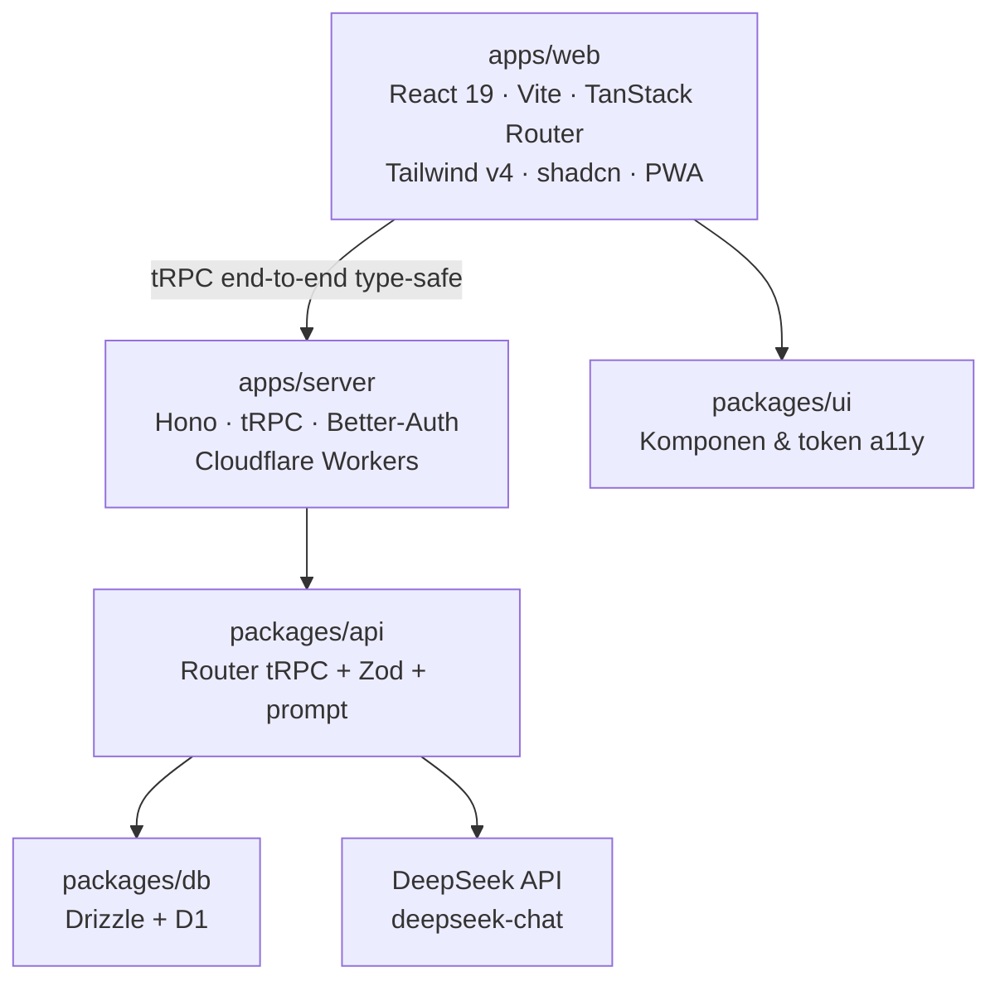

# Mudahin

**Platform pembelajaran inklusif & adaptif untuk siswa dengan kebutuhan khusus.**

Mudahin menyesuaikan cara materi dan kuis disajikan sesuai kebutuhan aksesibilitas tiap siswa — disleksia, ADHD, penglihatan rendah, dan kendala bahasa. Bukan sekadar "teks diperbesar": setiap bagian aplikasi (tipografi, pemandu baca, suara, bahasa materi, format kuis) beradaptasi pada satu **Focus Profile**.

> Hackathon JOINTS 2026 · Tema *Education* · Subtema *Siswa penyandang disabilitas / berkendala bahasa* · Target **WCAG 2.1 Level AA**.

---

## ✨ Fitur Inti

| Fitur | Ringkasan |
|---|---|
| **Onboarding & Profil Aksesibilitas** | Pilih kebutuhan (multi-pilih); preset tipografi diterapkan otomatis. |
| **Beranda** | Pintu masuk ke pustaka + tombol akses cepat (teks besar, pemandu baris, kontras tinggi). |
| **Pustaka Materi** | 6 materi contoh siap demo, filter per mata pelajaran. |
| **Focus Reader** | Tipografi adaptif, pengaturan jarak baris/huruf/font disleksia. |
| **Reading Ruler** | Pemandu baris yang mengikuti bacaan, bisa digeser dengan jari. |
| **Read-Aloud (TTS)** | Membacakan materi dengan penanda kata aktif; kecepatan 0.5–2×. |
| **AI Text Simplifier** | Menyederhanakan materi jadi poin-poin via DeepSeek, dapat dibacakan juga. |
| **Kuis Adaptif** | Soal dibuat dari materi; pada profil tertentu soal dapat dibacakan. |
| **Hasil Kuis** | Skor, pembahasan jawaban salah, dan opsi mengulang bagian yang salah. |
| **Pengaturan Aksesibilitas** | Semua toggle preferensi dalam satu halaman. |
| **Profil & Progres** | Ringkasan kebutuhan, penyesuaian aktif, dan ketuntasan pustaka. |

**Status:** seluruh fitur di atas adalah **Core (P0)** dan berjalan end-to-end. Daftar fitur lanjutan ada di [Future Work](#-future-work).

---

## 🚀 Menjalankan Proyek

**Prasyarat:** [Bun 1.3+](https://bun.sh). Jangan pakai npm/yarn/pnpm (lockfile resmi: `bun.lock`).

```bash
bun install          # pasang dependency semua workspace
```

Isi nilai rahasia (mis. `DEEPSEEK_API_KEY`) di `.env` sesuai [Konfigurasi](#-konfigurasi) sebelum menjalankan fitur AI.

```bash
bun run dev:stack    # jalankan web + server lokal (Cloudflare bindings via Alchemy)
```

Ini menjalankan Worker server **beserta binding D1 dan secret**-nya secara lokal, lalu menautkan web ke server tersebut. Buka:

- Web — <http://localhost:3001>
- API — <http://localhost:3000>

Hanya ingin mengerjakan frontend (tanpa D1/AI lokal)? Pakai `bun run dev:web`.

Untuk demo di HP, buka `http://<IP-komputer>:3001` dari jaringan yang sama (aplikasi ini mobile-first dan dapat dipasang sebagai PWA).

### Perintah Penting

| Perintah | Fungsi |
|---|---|
| `bun run dev:stack` | Web + server lokal sekaligus (via Alchemy, dengan bindings) |
| `bun run dev:web` | Frontend saja (Vite, port 3001) |
| `bun run build` | Build semua aplikasi |
| `bun run check-types` | Cek tipe seluruh workspace |
| `bun run check` / `bun run fix` | Lint & format (Ultracite/Biome) |
| `bun run db:generate` | Generate migrasi Drizzle |
| `bun run env:generate` | Regenerate `src/env.ts` dari skema Varlock |
| `bun run prewarm` | Panaskan cache AI untuk semua materi demo |
| `bun run deploy` / `bun run destroy` | Deploy/hapus infrastruktur Cloudflare (Alchemy) |

---

## 🧭 Alur Demo (5 Detik)

> **Buka → Pustaka → pilih materi → Sederhanakan → Bacakan → Kuis → Hasil.**

1. **Onboarding** — pilih kebutuhan (mis. *Disleksia* + *Penglihatan Rendah*). Tampilan langsung menyesuaikan.
2. **Beranda** — tekan **Mulai Belajar**.
3. **Pustaka** — pilih salah satu materi.
4. **Focus Reader** — aktifkan *Pemandu* dan *Bacakan*; kata yang dibaca disorot.
5. **Sederhanakan** — AI mengubah materi menjadi poin-poin sederhana.
6. **Mulai Kuis** — jawab soal, lalu lihat **Hasil** beserta pembahasan.

**Protokol sebelum pitch:** jalankan `bun run prewarm` agar hasil AI tersimpan di cache, lalu uji aplikasi dalam mode luring. Materi tetap tersedia dari salinan lokal saat jaringan mati.

---

## 🏗️ Arsitektur

Monorepo **Turborepo + Bun workspaces** dengan pemisahan tegas antara *apps* (deployable) dan *packages* (library internal).



| Lapisan | Teknologi |
|---|---|
| Monorepo | Turborepo + Bun workspaces |
| Frontend | React 19, Vite, TanStack Router, TanStack Query, Zustand, Tailwind v4, shadcn/ui |
| Backend | Hono + tRPC di Cloudflare Workers (deploy via Alchemy) |
| Database | Cloudflare D1 (SQLite) + Drizzle ORM |
| AI | DeepSeek `deepseek-chat` (server-side, timeout 8s, cache di D1) |
| TTS | Web Speech API (di sisi klien) |
| PWA | `vite-plugin-pwa` — dapat dipasang & luring |

### Struktur Folder

```
mudahin/
├── apps/
│   ├── web/         # Frontend (vertical-slice per route — lihat apps/web/ARCHITECTURE.md)
│   └── server/      # Hono + tRPC (Cloudflare Worker)
├── packages/
│   ├── api/         # Kontrak & logika: router tRPC, skema Zod, prompt, cache AI
│   ├── auth/        # Konfigurasi Better-Auth
│   ├── db/          # Skema Drizzle + migrasi
│   ├── ui/          # Komponen shadcn & token aksesibilitas lintas-app
│   ├── config/      # tsconfig & preset lint bersama
│   └── infra/       # Definisi infrastruktur Alchemy (Worker + D1 + Website)
├── scripts/         # Utilitas (prewarm, verifikasi)
└── turbo.json
```

Detail arsitektur frontend (vertical slice) ada di [`apps/web/ARCHITECTURE.md`](apps/web/ARCHITECTURE.md); aturan teknis lengkap ada di [`ATURAN-TEKNIS.md`](../ATURAN-TEKNIS.md).

---

## ♿ Aksesibilitas

Dibangun mengacu pada **WCAG 2.1 AA**:

- Rasio kontras teks minimum **4.5:1** (tersedia mode kontras tinggi).
- Target sentuh minimum **44×44 px**; aplikasi mobile-first & *gesture friendly* (bottom sheet, tab bar bawah, area aman perangkat).
- Setiap kontrol punya **ARIA label** dan dapat diakses keyboard; ikon aksi utama selalu disertai label teks.
- Ukuran teks mulai 16px dan dapat diperbesar hingga **200%** tanpa merusak layout.
- Informasi tidak pernah disampaikan hanya lewat warna.
- Animasi (GSAP) menghormati `prefers-reduced-motion` **dan** preferensi "Kurangi animasi" di aplikasi.
- Font **OpenDyslexic** tersedia untuk profil disleksia.

---

## 🔌 Konfigurasi

Konfigurasi environment memakai **Varlock**: hanya file `*.env.schema` yang di-commit (tanpa nilai rahasia).

| File skema | Variabel |
|---|---|
| `apps/web/.env.schema` | `NODE_ENV`, `VITE_SERVER_URL` |
| `apps/server/.env.schema` | `NODE_ENV`, `BETTER_AUTH_SECRET`, `BETTER_AUTH_URL`, `CORS_ORIGIN` |
| `packages/infra/.env.schema` | Impor server + `DEEPSEEK_API_KEY`, `DEEPSEEK_BASE_URL`, `DEEPSEEK_MODEL`, `PREWARM_TOKEN`, `ALCHEMY_PASSWORD` |

Salin skema ke `.env` lokal (mis. `packages/infra/.env`) dan isi nilai rahasianya. Alchemy memuat dan memvalidasi nilai ini saat `bun run dev:stack` / `bun run deploy`, lalu menyuntikkannya ke Worker sebagai binding. File `.env` **gitignored** — jangan pernah commit secret, dan jangan memakai prefix `VITE_` untuk key rahasia (variabel `VITE_*` ikut ter-bundle ke client).

---

## 🛡️ Ketahanan Demo

- **Timeout 8 detik** + 1 retry untuk setiap panggilan DeepSeek; kegagalan menampilkan banner fallback (layar tidak pernah kosong).
- **Cache hasil AI di D1** dengan key = hash `(endpoint + versi prompt + input)` → respons identik tidak memanggil API ulang.
- **Mode luring penuh (IndexedDB)** — materi, ringkasan, peta pikiran, dan kuis terakhir disalin ke perangkat (`apps/web/src/lib/offline/idb.ts`). Pustaka & Focus Reader memakai prioritas: server → salinan luring → seed statis, sehingga aplikasi tetap terbaca saat jaringan mati.
- Semua respons AI **divalidasi Zod** sebelum dikirim ke client.
- **Verifikasi util kritis**: `bun run verify` (reading ruler, parser JSON LLM, guard anti-loop, STT, cache luring).

---

## 🤖 Pencantuman AI

Sesuai Rules Lomba, peran AI dalam proyek ini:

| Tahap | AI / Tools | Peran |
|---|---|---|
| Riset & penulisan SRS | LLM asisten | Penyusunan dokumen & pemetaan kebutuhan |
| Pengembangan kode | AI coding assistant | Scaffolding monorepo, komponen UI, integrasi tRPC/Drizzle |
| **Fitur produk** | **DeepSeek `deepseek-chat`** | Penyederhanaan teks, generasi kuis |
| **Fitur produk** | **Web Speech API** (bukan AI generatif) | TTS di sisi klien |
| Desain UI/UX | AI design assistant | Eksplorasi layout & sistem warna ramah aksesibilitas |

---

## 🌱 Future Work

Fitur berikut **belum dikerjakan** dan hanya ada di roadmap proposal (SRS Bagian 8): avatar isyarat **BISINDO 3D**, **AI Dialect Adapter** bahasa daerah, **OCR tulisan tangan** → flashcard, **Teacher & Parent Dashboard**, haptic feedback engine, sinkronisasi profil lintas perangkat, dan evaluasi khusus siswa tunarungu.

---

## 📄 Lisensi

Karya orisinal untuk Hackathon JOINTS 2026.
