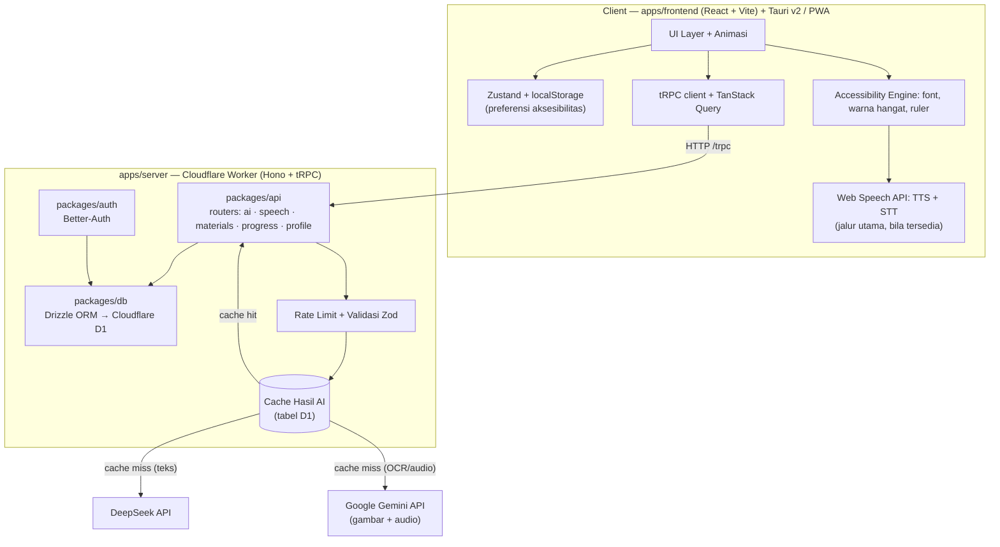

# Software Requirements Specification (SRS)

## Mudahin — Platform Pembelajaran Inklusif & Adaptif

| Item | Keterangan |
|---|---|
| Proyek | Mudahin |
| Kompetisi | JOINTS 2026 — **Hackathon** |
| Tema | Education |
| Subtema | 2 — Siswa penyandang disabilitas / berkendala bahasa |
| Standar | IEEE Std 830-1998 / ISO 29148 |
| Target Aksesibilitas | WCAG 2.1 Level AA |
| Versi Dokumen | v2.2 (Fitur & arsitektur diselaraskan dengan implementasi terbaru — materi dari DB, latihan multi-mode, TTS/STT server-side) |
| Tanggal | 13 Oktober 2026 |
| Batas Pengumpulan | 15–16 Oktober 2026 |

> **Catatan revisi v2.2:** Bagian kebutuhan fungsional (Bagian 3), arsitektur (Bagian 4), dan traceability (Bagian 7) diselaraskan dengan **implementasi repo terkini**. Perubahan utama dari v2.1: (a) materi **tidak lagi** berupa seed contoh — pustaka dibaca dari tabel `materials` di D1; (b) profil fokus kini diatur lewat **halaman Aksesibilitas** (bukan onboarding terpisah); (c) **flashcard, mind map, dan OCR tulisan tangan sudah berjalan**, bukan lagi Future Work; (d) TTS/STT kini punya **fallback server-side (Gemini)** di samping Web Speech API; (e) daftar prosedur tRPC diperluas (`ai.*`, `speech.*`, `materials.*`, `progress.*`, `profile.*`).
>
> **Catatan revisi v2.1:** Arsitektur teknis (Bagian 4) diselaraskan dengan struktur repository **terbaru**: Turborepo + **Bun workspaces**, `apps/frontend` (React + Vite + Tailwind v4 + PWA + Tauri v2) dan `apps/server` (Hono + tRPC di Cloudflare Workers), dengan `packages/{api,auth,db,ui,config,infra}` dan database **Cloudflare D1 + Drizzle**. Kontrak API kini memakai **tRPC**, bukan REST manual.
>
> **Catatan revisi v2.0:** Dokumen ini menggantikan v1.0. V1.0 berisi visi produk jangka panjang; v2.0 memisahkan secara tegas antara **MVP (Core)** yang dibangun & didemokan dalam 3 hari, dan **Future Work** yang hanya ditulis sebagai roadmap di proposal. Pemisahan ini dilakukan karena bobot penilaian **Implementasi Teknis (30%)** dan **Fungsionalitas & Desain (20%)** dihargai berdasarkan apa yang benar-benar berjalan saat demo.

---

## 1. Pendahuluan

### 1.1 Tujuan Dokumen

Dokumen ini mendefinisikan kebutuhan fungsional, non-fungsional, arsitektur, dan batasan teknis untuk pengembangan prototype **Mudahin** pada Hackathon JOINTS 2026. Dokumen ini adalah acuan tunggal untuk pengisian `README.md` repository, draf Proposal, dan isi Pitch Deck.

### 1.2 Lingkup Produk

Mudahin adalah aplikasi pembelajaran inklusif yang mengadaptasi penyajian materi dan evaluasi sesuai kebutuhan aksesibilitas tiap siswa (disleksia, ADHD, low vision, kendala bahasa). Sistem menyediakan:

1. **Focus Reader** — penyajian materi dengan pengaturan tipografi ramah disleksia dan pemandu baca (*reading ruler*).
2. **Read-Aloud (TTS)** — membacakan materi via Web Speech API, dengan **fallback suara server-side (Gemini)** bila perangkat tidak punya mesin suara.
3. **AI Text Simplifier** — penyederhanaan bahasa materi pelajaran via LLM (DeepSeek), disertai peta pikiran.
4. **Adaptive Quiz** — kuis yang formatnya menyesuaikan profil aksesibilitas siswa.
5. **Pusat Latihan multi-mode** — lima mode latihan dari satu materi: kartu tanya jawab, jawab dengan suara, dengarkan bacaan nyaring, kuis santai, dan Focus Reader.
6. **Pembuatan materi** — dari teks bebas, ucapan (STT), **foto catatan** (OCR Gemini), atau **berkas PDF** nyata; hasil disimpan ke pustaka pengguna di database.

**Di luar lingkup MVP:** avatar isyarat BISINDO 3D, terjemahan bahasa daerah, dan dashboard guru multi-pengguna. Lihat Bagian 8 (Future Work).

### 1.3 Definisi & Singkatan

| Istilah | Arti |
|---|---|
| WCAG 2.1 AA | Web Content Accessibility Guidelines, level kelayakan akses internasional |
| TTS | Text-to-Speech (suara dari teks) |
| STT | Speech-to-Text (teks dari suara) |
| LLM | Large Language Model |
| PWA | Progressive Web App (web yang dapat dipasang seperti aplikasi) |
| Focus Profile | Kumpulan preferensi aksesibilitas seorang siswa |
| MVP | Minimum Viable Product — fitur minimum yang wajib berjalan |

### 1.4 Asumsi & Batasan Operasional

- Dikerjakan oleh **1 developer** dalam **3 hari** efektif.
- Demo dilakukan **live** di hadapan juri; koneksi internet ruangan **tidak dapat dijamin**.
- AI diakses melalui **cloud API**: **DeepSeek** untuk seluruh fitur **teks**, dan **Google Gemini** untuk **gambar (OCR tulisan tangan)** serta **audio (TTS/STT server-side)** — bukan model on-device.
- Perangkat demo utama: **smartphone mid-range** (Android), fallback laptop.

---

## 2. Deskripsi Umum Sistem

### 2.1 Perspektif Produk

Mudahin adalah aplikasi mandiri (*standalone*) yang dapat digunakan siswa secara mandiri di luar kelas maupun sebagai pendamping saat pembelajaran di kelas. Pada versi MVP, aplikasi berjalan sebagai **PWA** (dapat dipasang di layar utama) dengan target pembungkusan mobile menggunakan **Tauri v2**.

### 2.2 Kelas Pengguna (User Classes)

| Kelas Pengguna | Deskripsi & Kebutuhan | Fitur Utama yang Digunakan |
|---|---|---|
| **Siswa Disleksia / ADHD** | Kesulitan memproses teks rapat dan mempertahankan fokus panjang | Focus Reader, Reading Ruler, TTS, Text Simplifier |
| **Siswa Low Vision** | Keterbatasan daya pandang | Ukuran teks besar, Filter Warna Hangat, TTS, Voice Input (STT) |
| **Siswa Kendala Bahasa** | Belum lancar Bahasa Indonesia baku | Text Simplifier, Read-Aloud |
| **Siswa Umum** | Ingin pengalaman belajar yang dapat disesuaikan | Focus Profile, Pustaka, Kuis |

> **Catatan:** Siswa tuli/tuna rungu tetap menjadi bagian narasi dampak produk, namun fitur penerjemahan isyarat diklasifikasikan sebagai **Future Work** (Bagian 8) karena tidak dapat diselesaikan secara kredibel dalam 3 hari.

### 2.3 Lingkungan Operasional

- Modern browser (Chrome/Edge/Safari) dengan dukungan Web Speech API.
- Android 8+ (PWA/APK Tauri) / iOS 15+ (PWA).
- Koneksi internet (dengan strategi caching + fallback). Bila perangkat tidak punya mesin suara, TTS/STT memakai server sehingga tetap membutuhkan jaringan.

---

## 3. Kebutuhan Fungsional (Functional Requirements)

Prioritas: **Must-Have (Core)** = wajib berjalan saat demo · **Should-Have** = dikerjakan hanya bila Core selesai · **Future** = ditulis di proposal, tidak dikoding.

### M1 — Visual & Tipografi Adaptif

| Kode | Kebutuhan | Prioritas | Status |
|---|---|---|---|
| FR-VIS-01 | Aplikasi menyediakan font ramah disleksia (**Lexend**, kelas `font-dyslexia`) dan font standar | Must-Have | ✅ |
| FR-VIS-02 | Pengguna dapat mengatur ukuran teks secara global lewat 4 tingkat (A-/A/A+/A++) berbasis variabel `--a11y-font-scale` | Must-Have | ✅ |
| FR-VIS-03 | Aplikasi menyediakan mode **Filter Warna Hangat (anti silau)** untuk mengurangi kelelahan mata | Must-Have | ✅ |
| FR-VIS-04 | Focus Reader menampilkan *reading ruler* untuk memandu fokus pada satu baris (mengikuti kursor/jari) | Must-Have | ✅ |
| FR-VIS-05 | Aplikasi menyediakan filter buta warna (protanopia/deuteranopia/tritanopia) | Should-Have | ⏳ |

> **Catatan implementasi:** model MVP memakai **skala huruf global** + **warna hangat**, bukan pengaturan `line-height`/`letter-spacing` manual atau dark mode penuh. Ini disederhanakan agar satu nilai menskalakan seluruh tipografi (semua UI ber-`rem`) tanpa label yang tertinggal kecil.

### M2 — Audio & Narasi

| Kode | Kebutuhan | Prioritas | Status |
|---|---|---|---|
| FR-AUD-01 | Aplikasi membacakan teks materi menggunakan TTS (Web Speech API) | Must-Have | ✅ |
| FR-AUD-02 | Saat TTS berjalan, `onboundary` memetakan posisi karakter → indeks kata untuk penanda visual | Must-Have | ✅ |
| FR-AUD-03 | Kecepatan TTS dapat diatur pengguna (0.8×/1.0×/1.25×, dinormalkan ke 0.5–2×) | Must-Have | ✅ |
| FR-AUD-04 | Aplikasi menyediakan input jawaban kuis berbasis suara (STT), dengan fallback `MediaRecorder` → `speech.transcribe` | Should-Have | ✅ |
| FR-AUD-05 | Bila perangkat tidak punya mesin suara, TTS diambil dari server (`speech.synthesize`, Gemini) | Should-Have | ✅ |

### M3 — AI Text Adaptation

| Kode | Kebutuhan | Prioritas | Status |
|---|---|---|---|
| FR-AI-01 | Aplikasi menyederhanakan teks materi menjadi bahasa yang lebih mudah dipahami via DeepSeek API | Must-Have | ✅ |
| FR-AI-02 | Hasil penyederhanaan disajikan sebagai poin-poin ringkas (`ai.simplify`) | Must-Have | ✅ |
| FR-AI-03 | Aplikasi menjelaskan potongan teks yang dipilih pengguna (`ai.explain`) | Should-Have | ✅ |
| FR-AI-04 | Hasil AI ditampilkan sebagai peta pikiran visual (`ai.mindMap`) | Should-Have | ✅ |
| FR-AI-05 | Hasil AI yang identik dapat dilayani dari cache tanpa memanggil API ulang (key = `endpoint + PROMPT_VERSION + input`) | Must-Have | ✅ |

### M4 — Adaptive Learning

| Kode | Kebutuhan | Prioritas | Status |
|---|---|---|---|
| FR-LEA-01 | Aplikasi menghasilkan kuis dari materi yang sedang dipelajari via DeepSeek API (`ai.quiz`, default 3 soal) | Must-Have | ✅ |
| FR-LEA-02 | Format penyajian kuis menyesuaikan Focus Profile (soal dibacakan untuk low vision, tipografi besar/minimal untuk ADHD) | Must-Have | ✅ |
| FR-LEA-03 | Aplikasi menampilkan skor, penjelasan jawaban, dan opsi mengulang kuis | Must-Have | ✅ |
| FR-LEA-04 | Aplikasi men-generate flashcard dari materi (`ai.flashcards`); dibalik dengan ketukan | Should-Have | ✅ |
| FR-LEA-05 | **Teman AI** membuat materi baru dari teks/ucapan/foto/PDF lalu menyimpannya ke pustaka (`materials.create`) | Should-Have | ✅ |
| FR-LEA-06 | Peta latihan menawarkan **5 mode** dari satu materi (flashcard, jawab suara, dengarkan bacaan, kuis, focus reader) | Should-Have | ✅ |

### M5 — Profil & Konten

| Kode | Kebutuhan | Prioritas | Status |
|---|---|---|---|
| FR-PRF-01 | Pengguna dapat mengatur kebutuhan aksesibilitas (multi-pilih) lewat halaman **Akses** dan bottom sheet cepat | Must-Have | ✅ |
| FR-PRF-02 | Pilihan aksesibilitas mengubah tipografi, tema warna, dan default penyajian kuis secara global, serta dihimpun jadi **Focus Profile** yang dikirim ke AI | Must-Have | ✅ |
| FR-PRF-03 | Pengguna dapat mengubah preferensi aksesibilitas kapan saja; setelan persisten lintas reload | Must-Have | ✅ |
| FR-PRF-04 | Aplikasi menyediakan pustaka materi **milik pengguna dari database** (bukan seed contoh) | Must-Have | ✅ |
| FR-PRF-05 | Aplikasi menyimpan progres belajar (skor kuis terbaik + hitungan) lewat `progress.record`, ditampilkan di Profil | Must-Have | ✅ |
| FR-PRF-06 | Aplikasi menyimpan materi & hasil AI untuk akses luring terbatas (IndexedDB) | Should-Have | ✅ |
| FR-PRF-07 | Pengguna dapat mencadangkan/memulihkan **seluruh data** (setelan aksesibilitas, pustaka materi, progres) lintas perangkat lewat "kode cadangan" (`backup.save`/`backup.load` + `data.export`/`data.import`, tanpa akun). Tanpa pemulihan, perangkat baru mulai dari nol | Should-Have | ✅ |

---

## 4. Arsitektur Teknis

### 4.1 Gambaran Umum



### 4.2 Keputusan Arsitektur

| Keputusan | Alasan |
|---|---|
| **API key AI hanya di server (Worker)** | Keamanan. Client tidak boleh pernah menerima API key (DeepSeek **maupun** Gemini); secret diakses via binding Worker. |
| **Semua panggilan AI melalui tRPC di `apps/server`** | Terpusat, type-safe end-to-end, mudah di-cache dan di-fallback saat demo. |
| **Dua provider dengan pembagian tugas** | **DeepSeek** untuk seluruh **teks** (simplify, quiz, explain, mindmap, flashcards); **Gemini** untuk **gambar** (OCR tulisan tangan) dan **audio** (TTS/STT server-side). Memisahkan beban & memakai kekuatan masing-masing. |
| **Cache hasil AI di Cloudflare D1** | Antisipasi jaringan ruangan demo. Materi yang sama cukup dipanggil sekali; TTS di-cache per kalimat. |
| **TTS/STT dua jalur (klien dulu, server fallback)** | WebView Android/APK Tauri umumnya tidak mengekspos mesin suara. Web Speech API dipakai bila ada; kalau tidak, audio diproses di server dan diputar lewat `<audio>`. |
| **PWA sebagai target demo utama** | Risiko teknis jauh lebih rendah daripada build Tauri mobile langsung. |
| **Tauri v2 di dalam `apps/frontend/src-tauri`** | Membungkus UI web yang sama; tetap ada di repo sebagai bukti arsitektur cross-platform. |
| **Monorepo Turborepo + Bun workspaces** | Berbagi tipe TypeScript antar aplikasi, build caching, satu perintah menjalankan seluruh stack. |
| **Runtime Cloudflare Workers + Alchemy** | Deploy server & web dari satu definisi infra (`packages/infra/alchemy.run.ts`). |
| **Cloudflare D1 (SQLite) + Drizzle ORM** | Ringan, tanpa server DB terpisah; tipe aman lewat Drizzle. |
| **Autentikasi Better-Auth** | Fondasi akun opsional tanpa membangun auth manual; bukan dashboard multi-pengguna (Future Work). |
| **Frontend berbasis fitur (`src/lib/`) + UI tipis** | Logika non-UI (luring, state, suara) terpisah dari komponen; mudah dipakai ulang lintas tab. |
| **DeepSeek `deepseek-chat`** | Murah dan cepat. `deepseek-reasoner` terlalu lambat untuk UI realtime. |

### 4.3 Struktur Monorepo (Turborepo + Bun)

```
mudahin/
├── apps/
│   ├── server/         # Hono + tRPC + Better-Auth — Cloudflare Worker
│   └── frontend/       # React + Vite + Tailwind v4 + PWA (UI utama) + Tauri v2
│       └── src-tauri/  # Pembungkus Tauri v2 (desktop + Android)
├── packages/
│   ├── api/            # Router & prosedur tRPC (kontrak + business logic)
│   ├── auth/           # Konfigurasi Better-Auth
│   ├── db/             # Skema Drizzle + koneksi D1
│   ├── ui/             # Komponen & style shadcn lintas-app
│   ├── config/         # tsconfig & preset lint bersama
│   └── infra/          # Definisi infra Alchemy (Worker + D1 + Website → apps/frontend)
├── turbo.json
├── package.json        # Bun workspaces + catalog
└── bun.lock
```

### 4.4 Kontrak API (tRPC)

Endpoint diakses lewat tRPC client (`apps/frontend/src/lib/trpc.ts`), bukan REST manual. Prosedur didefinisikan di `packages/api/src/routers`.

| Router | Tipe | Prosedur | Input | Output |
|---|---|---|---|---|
| — | query | `healthCheck` | — | `string` ("OK") |
| `ai` | mutation | `simplify` | `{ text, level?, profile? }` | `{ points: string[], cached }` |
| `ai` | mutation | `explain` | `{ text, context?, profile? }` | `{ explanation, cached }` |
| `ai` | mutation | `quiz` | `{ text, count, profile? }` | `{ questions: Question[], cached }` |
| `ai` | mutation | `mindMap` | `{ text, profile? }` | `{ root, branches[], cached }` |
| `ai` | mutation | `flashcards` | `{ text, profile? }` | `{ deckTitle, cards[], cached }` |
| `ai` | mutation | `ocrToFlashcards` | `{ imageDataUrl, profile?, hint? }` | `{ extractedText, deckTitle, cards[], cached }` (Gemini) |
| `speech` | mutation | `synthesize` | `{ text, rate? }` | `{ audioDataUrl, mimeType }` (Gemini) |
| `speech` | mutation | `transcribe` | `{ audioDataUrl }` | `{ text }` (Gemini) |
| `materials` | query | `list` | — | `Material[]` (milik pengguna) |
| `materials` | query | `byId` | `{ id }` | `Material \| null` |
| `materials` | mutation | `create` | `materialInputSchema` | `Material` |
| `progress` | mutation | `record` | `{ materialId, score }` | `{ bestScore, quizCount, materialId }` |
| `progress` | query | `summary` | — | `{ items[], quizzedCount, averageScore }` |
| `profile` | mutation | `save` | `{ syncId, snapshot }` | `{ ok, syncId, updatedAt }` |
| `profile` | query | `load` | `{ syncId }` | `{ found, snapshot \| null }` |

> Endpoint autentikasi Better-Auth tetap REST di `/api/auth/*` (kebutuhan adapter). Sisanya lewat tRPC di `/trpc/*`.

### 4.5 Strategi Ketahanan Demo (Wajib)

1. **Timeout 8 detik** pada setiap panggilan DeepSeek (Gemini 10 detik untuk OCR), maksimal **1 retry**.
2. **Fallback:** tampilkan teks asli + banner "AI sedang sibuk, coba lagi" — **layar tidak boleh kosong**.
3. **Pra-panaskan cache** untuk seluruh materi yang akan didemokan (`bun run prewarm`, dijalankan sekali sebelum pitch).
4. **Mode demo luring:** materi + hasil AI terakhir tersimpan di IndexedDB sehingga demo tetap berjalan tanpa internet.
5. **Fallback suara:** bila perangkat tidak punya mesin suara, TTS/STT dialihkan ke server (Gemini); bila server juga tak tersedia, tombol suara menampilkan pesan jujur.

---

## 5. Kebutuhan Non-Fungsional

| Kategori | Spesifikasi & Target |
|---|---|
| **Aksesibilitas (WCAG 2.1 AA)** | Rasio kontras ≥ 4.5:1, ARIA label, navigasi keyboard, target sentuh ≥ 44×44 px, dukungan screen reader dasar |
| **Performa** | Waktu respon navigasi < 100 ms; waktu muat awal < 3 s pada 3G cepat; efek transisi ≥ 30 fps |
| **Usability** | Prinsip *One-Tap Access*; target System Usability Scale (SUS) ≥ 80 |
| **Reliabilitas** | Fitur inti (ringkasan AI, kuis, kartu, TTS) tetap berfungsi dari cache D1 & salinan IndexedDB saat offline |
| **Keamanan** | API key (DeepSeek & Gemini) hanya di server; validasi Zod & pembatasan panjang input (teks maks 8.000 karakter, gambar maks 4 MB, audio maks 3 MB); job pra-panas dijaga `PREWARM_TOKEN`; tidak menyimpan data pribadi sensitif |
| **Portabilitas** | Berjalan di browser modern dan dapat dipasang sebagai PWA (`apps/frontend`); target mobile via Tauri v2 (`apps/frontend/src-tauri`) |

---

## 6. Batasan yang Diakui (Explicit Non-Goals MVP)

Bagian ini **wajib disampaikan secara jujur** di pitch deck. Menyatakan batasan dengan jelas lebih dihargai juri daripada mengklaim fitur yang tidak ada:

- Avatar isyarat **BISINDO 3D real-time** belum diimplementasikan.
- **AI on-device / Edge AI** tidak digunakan; sistem memakai **DeepSeek & Gemini berbasis cloud** dengan caching.
- **OCR tulisan tangan** (`ai.ocrToFlashcards`) **sudah berjalan**, namun akurasinya belum pada tingkat produksi — teks hasil baca ditampilkan untuk dikoreksi pengguna.
- Belum ada **autentikasi & dashboard guru** multi-pengguna.
- **Filter buta warna**, **dark mode penuh**, dan pengaturan `line-height`/`letter-spacing` manual **belum** ada (lihat catatan implementasi Bagian 3, M1).

---

## 7. Traceability — Kebutuhan ke Permukaan UI

Tab utama: **Belajar**, **Latihan**, **Akses**, **Profil** (tab bar bawah), ditambah modal/sheet.

| Kebutuhan | Permukaan UI |
|---|---|
| FR-PRF-01, FR-PRF-02, FR-PRF-03 | Tab **Akses** + **AccessibilitySheet** (navbar `tune`) |
| FR-PRF-04, FR-PRF-05, FR-PRF-07 | Tab **Belajar** (pustaka + Teman AI), **Latihan**, tab **Profil** |
| FR-VIS-01..04, FR-AUD-01..03 | **Focus Reader** (modal) |
| FR-AI-01, FR-AI-02, FR-AI-04 | **Focus Reader** (Buat Lebih Santai/Jelaskan), ringkasan AI & peta pikiran |
| FR-AI-05 (cache) | Seluruh `ai.*` (server-side, transparan ke UI) |
| FR-LEA-01..03 | **Kuis Santai Adaptif** (modal) |
| FR-LEA-04, FR-AUD-04, FR-LEA-06 | **PracticePickerSheet** → **Flashcard** & **Jawab dengan Suara** |
| FR-LEA-05 | Tab **Belajar** → kotak **Teman AI** (teks/foto/PDF/suara) |
| FR-AUD-05 | Tombol suara di seluruh aplikasi (fallback server) |

---

## 8. Future Work (Roadmap)

Sebagian item berikut **sudah dikerjakan** karena waktu tersisa (ditandai ✅); sisanya tetap roadmap:

| Fitur | Status | Alasan Ditunda / Catatan |
|---|---|---|
| Avatar isyarat **BISINDO 3D** (Three.js) | ⏳ roadmap | Butuh dataset gesture, rigging, dan animator; riset berbulan-bulan |
| **AI Dialect Adapter** (Jawa/Sunda/Makassar) | ⏳ roadmap | Butuh korpus bahasa daerah & evaluasi kualitas terjemahan |
| **OCR tulisan tangan → flashcard** | ✅ selesai | Gemini vision (`ai.ocrToFlashcards`); akurasi belum tingkat produksi, teks ditampilkan untuk dikoreksi |
| **Teacher & Parent Dashboard** | ⏳ roadmap | Butuh autentikasi, role, dan sinkronisasi multi-pengguna |
| **Haptic Feedback Engine** | ✅ selesai | Getar opsional via `navigator.vibrate`, terhubung ke mikro-interaksi tekan |
| **Sinkronisasi profil lintas perangkat** | ✅ selesai (MVP) | Lewat "kode cadangan" `backup.save`/`backup.load` — snapshot penuh: setelan, pustaka materi, dan skor. Identitas perangkat (`deviceId`) memisahkan data antar perangkat tanpa akun |
| **Flashcard dari materi** | ✅ selesai | `ai.flashcards` + modal kartu (FR-LEA-04) |
| **Mind map visual** | ✅ selesai | `ai.mindMap` |
| **Build Android Tauri v2** | ✅ selesai | Proyek di `apps/frontend/src-tauri/gen/android`, APK arm64 `com.mudahin.app` |
| **Evaluasi siswa tunarungu (BISINDO)** | ⏳ roadmap | Perlu tahap riset lapangan |

---

## 9. Peran AI dalam Pengembangan (Wajib untuk Pitch Deck)

Sesuai Rules Lomba poin 4, berikut pencantuman penggunaan AI:

| Tahap | AI / Tools | Peran |
|---|---|---|
| Riset & penulisan SRS | LLM asisten | Penyusunan dokumen, pemetaan kebutuhan |
| Pengembangan kode | AI coding assistant | Scaffolding monorepo (Turborepo + Bun), komponen UI, integrasi tRPC/Drizzle, pemisahan UI (`components/`) dari logika (`lib/`) |
| **Fitur produk** | **DeepSeek `deepseek-chat` API** | Seluruh fitur **teks**: penyederhanaan, penjelasan, generasi kuis, peta pikiran, kartu belajar |
| **Fitur produk** | **Google Gemini (`gemini-2.5-flash`)** | **OCR tulisan tangan** (`ai.ocrToFlashcards`) dan **TTS/STT server-side** (`speech.synthesize`/`speech.transcribe`) |
| **Fitur produk** | **Web Speech API** (bukan AI generatif) | TTS & STT di sisi klien (jalur utama sebelum fallback server) |
| Desain UI/UX | AI design assistant | Eksplorasi layout & sistem warna ramah aksesibilitas |

---

## 10. Ringkasan Kepatuhan Submission

| Item Submission | Status | Acuan |
|---|---|---|
| Repository GitHub + `README.md` | Wajib | Bagian 4.3 & dokumen `RUNDOWN.md` |
| Prototype aplikasi (berjalan) | Wajib | MVP Bagian 3 |
| Video (maks 2 menit) | Wajib | Demo Core Bagian 3 |
| Proposal A4 (maks 10 halaman) | Wajib | Dokumen ini + Bagian 8 |
| Pitch Deck | Wajib | Bagian 7, 8, 9 |
| Pencantuman penggunaan AI | Wajib | Bagian 9 |
